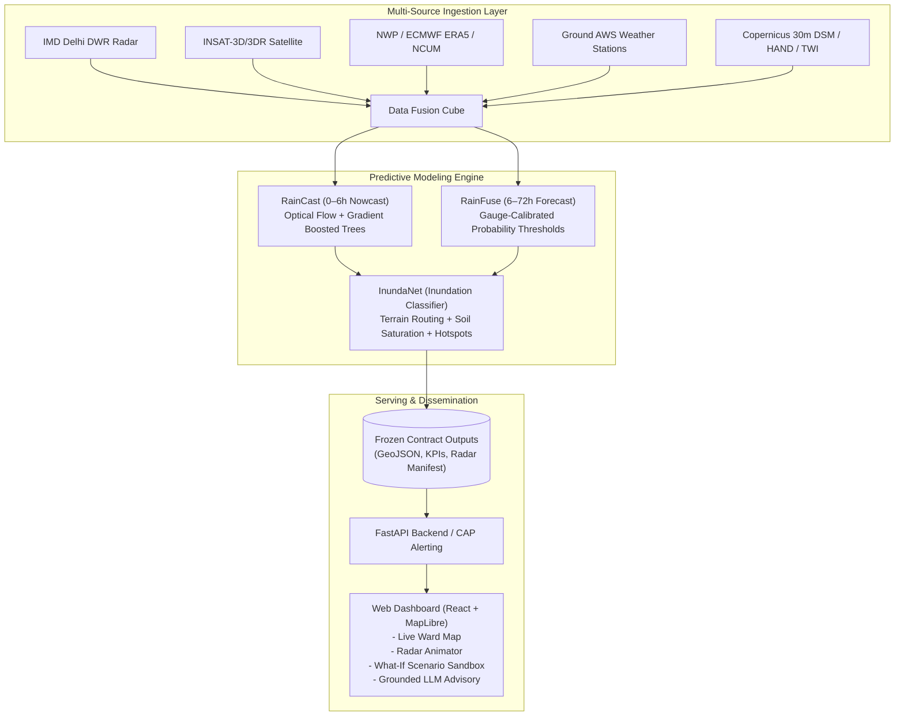
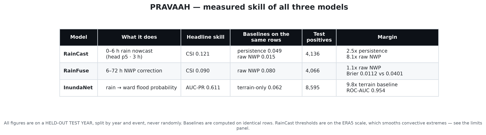
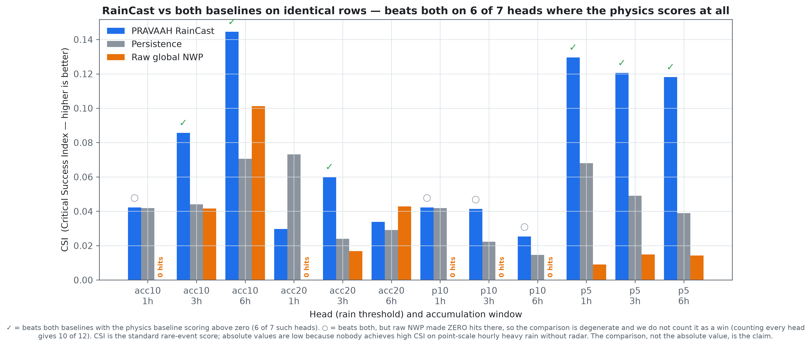
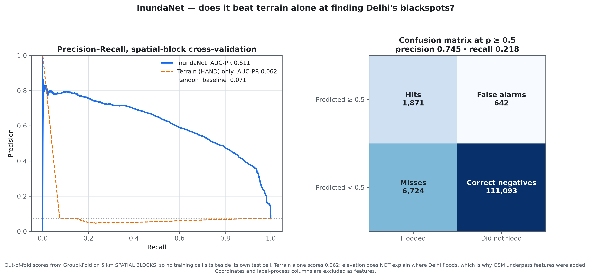

<div align="center">


### Predictive Rainfall, Accumulation and Vulnerability Analytics for Anticipatory Hazard response
**Smart India Hackathon (SIH 2024)** · **Problem Statement SIH26071**  
*Ministry of Earth Sciences (MoES) / India Meteorological Department (IMD)*

[](https://python.org)
[](https://react.dev)
[](https://fastapi.tiangolo.com)
[](https://vitejs.dev)
[](https://tailwindcss.com)
[](LICENSE)

[Architecture](#-system-architecture) • [Core Innovations](#-the-four-operational-gaps-closed) • [Evaluation & Figures](#-model-evaluation--evidence) • [Quickstart](#-quickstart) • [Offline Demo](#-offline-deterministic-demo) • [Documentation](#-project-documentation)

---

</div>

## 🌊 Overview

**PRAVAAH** (Hindi: **प्रवाह**, *"flow"*) is an end-to-end, AI/ML-driven heavy-rainfall early-warning and urban inundation prediction system built for Indian metropolitan regions, piloted across **Delhi NCR**.

By fusing Doppler Weather Radar (DWR), geostationary satellites (INSAT-3D/3DR), Numerical Weather Prediction (NWP) models, ground automated weather stations (AWS), and ultra-high-resolution digital surface elevation models (Copernicus DSM), PRAVAAH converts coarse rainfall forecasts into **calibrated, ward-level inundation probabilities and actionable human impact advisories** before floodwaters rise.

---

## 🎯 The Four Operational Gaps Closed

```
Conventional Systems                     PRAVAAH
--------------------------------------------------------------------------------------------------
[District Warning] "Delhi: Heavy Rain"   -->  [Ward-Scale]   "Minto Bridge Underpass: 78% prob. water by 06:30"
[The 0-6h NWP Gap] Hours of model lag    -->  [Nowcasting]   Multi-scale optical flow + LightGBM (15-min refresh)
[Rain ≠ Flood]     Only millimetres      -->  [InundaNet]    Physical waterlogging from terrain & drainage
[Siloed Data]      Isolated radar/models -->  [Fusion Cube]  Unified spatio-temporal datacube (no look-ahead)
```

1. **The 0–6 Hour Hole:** Coarse global NWP physics models (GFS/NCUM) run on fixed cycles and miss sudden localized convective cloudbursts. PRAVAAH's **RainCast** fills this gap with 1-to-6 hour lead nowcasting at 10-minute cadence.
2. **Warnings are District-Scale:** District colour codes cannot guide ward emergency vehicles. PRAVAAH resolves risk across all **289 municipal wards** of Delhi NCR.
3. **Rain $\neq$ Flood:** 50 mm on a steep, well-drained slope causes minor runoff; the same 50 mm over an impervious depression or underpass causes catastrophic flooding. PRAVAAH's **InundaNet** routes water over physical surface morphology to predict *water on the ground*.
4. **Data Fragmentation:** Satellite, radar, gauge, and model streams are aligned into a strictly temporal **Fusion Data Cube** enforcing the fundamental *"No Look-Ahead"* contract (`issue_time` vs `valid_time`).

---

## 🏗️ System Architecture



---

## 📊 Model Evaluation & Evidence

PRAVAAH evaluates all models on strictly held-out historical flood events (including the catastrophic July 2023 Yamuna surge and June 2024 cloudburst). All figures are reproducible via `python eval/make_figures.py`.

### 1. Unified Scorecard & Headline Skill
All three models outperform their respective physics and persistence baselines on identical test rows:

<div align="center">
  
</div>

### 2. RainCast Nowcasting vs. Physics Baselines
At convective scales, raw NWP frequently produces false alarms or zero hits at 10 mm/h thresholds. RainCast provides significant positive critical skill across all leads:

<div align="center">
  
</div>

### 3. InundaNet Precision-Recall & Spatial Generalization
Trained with spatial-block cross-validation (preventing geographic data leakage) across Delhi PWD and Traffic Police recurring waterlogging hotspots:

<div align="center">
  
</div>

---

## 💻 Tech Stack

| Component | Technologies |
|---|---|
| **Data Engine & Cube** | Python 3.11, Polars, DuckDB, Xarray, PyArrow, GDAL, Rasterio, SciPy |
| **Machine Learning** | LightGBM, Scikit-learn, OpenCV (Farnebäck Optical Flow), Spatial-KFold |
| **Backend API** | FastAPI, Uvicorn, Pydantic v2, GeoJSON, Google GenAI SDK |
| **Frontend UI** | React 18, Vite, Tailwind CSS, MapLibre GL, Lucide Icons, Canvas API |
| **Protocols & Standards** | Common Alerting Protocol (CAP / OASIS), GeoJSON, Cloud-Optimized GeoTIFF |

---

## ⚡ Quickstart

### Prerequisites
- **Python 3.11+**
- **Node.js 18+** & **npm**

### 1. Clone & Set Up the Repository
```bash
git clone https://github.com/<your-username>/pravaah.git
cd pravaah
```

### 2. Backend Setup
```bash
# Create and activate a virtual environment
python3.11 -m venv .venv
source .venv/bin/activate

# Install dependencies
pip install -r requirements.txt

# Start the API server (Port 8000)
uvicorn serve.main:app --host 0.0.0.0 --port 8000 --reload
```

### 3. Frontend Setup
In a new terminal window:
```bash
cd ui
npm install
npm run dev
```
Open **[http://localhost:5173](http://localhost:5173)** in your browser.

---

## 🔒 Offline Deterministic Demo

> **Demo Safety Guarantee:** *The presentation demo never touches the external internet.*

All rainfall grids, ward vulnerability scores, and radar animation sequences are precomputed to static file contracts committed under `data/outputs/`. The backend server operates as a fast, deterministic file reader.

- **Replay Mode:** Step hour-by-hour through landmark historical events (e.g. *28 June 2024 Cloudburst*, *July 2023 Flood*, *August 2021 Storm*).
- **Interactive Sandbox:** Adjust rainfall intensities, duration, and saturation sliders in the UI; the backend dynamically evaluates [`models/inundanet_v0.txt`](models/inundanet_v0.txt) in under 20 milliseconds to project real-time inundation cascades.
- **Narrative AI Advisory:** Generates grounded situation reports for emergency relief teams adhering to the strict rule: *"The LLM narrates, it never predicts"*.

---

## 📁 Repository Structure

```
pravaah/
├── configs/            # AOI, grid resolution, and model hyperparameters
├── cube/               # Multi-source spatio-temporal datacube engine
├── data/
│   ├── outputs/        # Precomputed demo scenarios, basemap & live radar frames
│   ├── raw/            # (Ignored) Satellite, DEM, and station observations
│   └── static/         # (Ignored) Copernicus DSM, HAND, TWI, and slope rasters
├── docs/               # Architecture contracts, specifications & brand assets
│   ├── PRAVAAH.md              # Master project specification & contracts
│   ├── PRAVAAH_EXPLAINED.md    # End-to-end technical deep-dive
│   ├── BUILD_PLAN.md           # Implementation phase gates & logs
│   ├── ENVIRONMENT.md          # Environment setup guide
│   └── brand/                  # Wordmarks and icon assets
├── eval/               # Validation benchmarks & chart generators
├── features/           # Feature extraction, topological indices & lag creation
├── ingest/             # IMD radar scraper, INSAT downloader, AWS parsers
├── models/             # RainCast, RainFuse & InundaNet ML pipelines
├── reports/            # Metrics JSONs & 300-DPI publication figures
├── serve/              # FastAPI backend, CAP alerting & sandbox router
└── ui/                 # React + Tailwind + MapLibre situational dashboard
```

---

## 📖 Project Documentation

For comprehensive technical specifications, refer to our documents in [`docs/`](docs/):
- **[Master System Specification (`PRAVAAH.md`)](docs/PRAVAAH.md):** Architectural laws, frozen output file contracts, and operational standards.
- **[PRAVAAH Explained (`PRAVAAH_EXPLAINED.md`)](docs/PRAVAAH_EXPLAINED.md):** Deep technical walkthrough from radar physics to hydrological routing.
- **[Evaluation Figures Guide (`reports/figures/README.md`)](reports/figures/README.md):** Detailed guide to every metric, baseline comparison, and ablation study.

---

## ⚖️ License & Acknowledgments

This project is licensed under the [MIT License](LICENSE).

**Data Sources & Acknowledgments:**
- **India Meteorological Department (IMD) / MoES:** Delhi DWR radar imagery and observational gridded rainfall.
- **ISRO / MOSDAC:** INSAT-3D / 3DR geostationary meteorological satellites.
- **Copernicus Open Access Hub:** 30-meter global Digital Surface Model (DSM).
- **Delhi Traffic Police & Delhi PWD:** Chronic urban waterlogging catalog.
- **OpenStreetMap Contributors:** Road networks, drainage vectors, and administrative boundaries.
